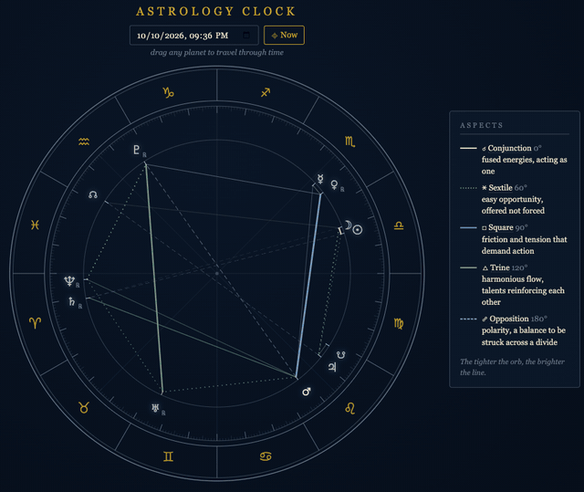
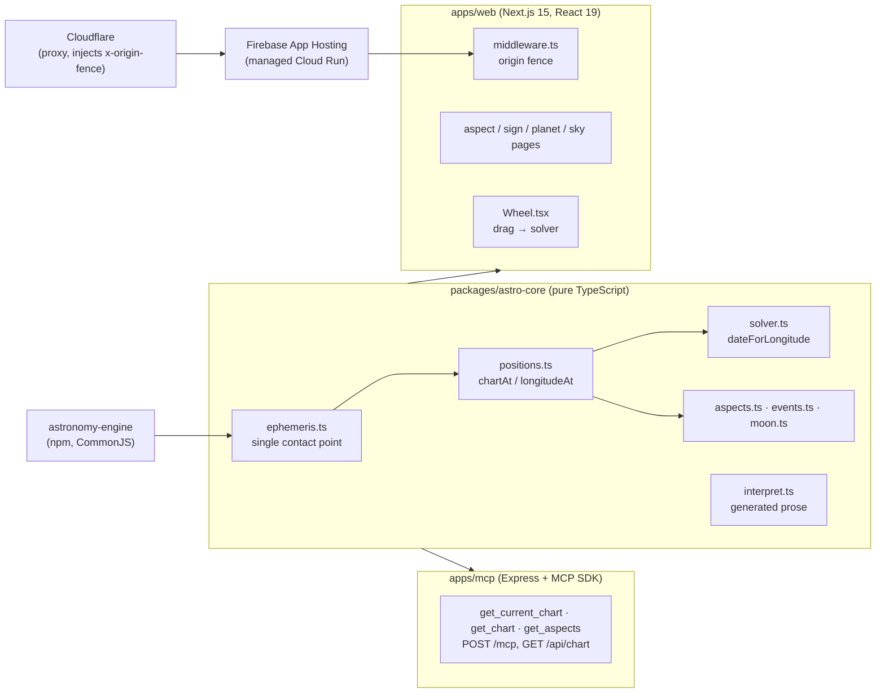
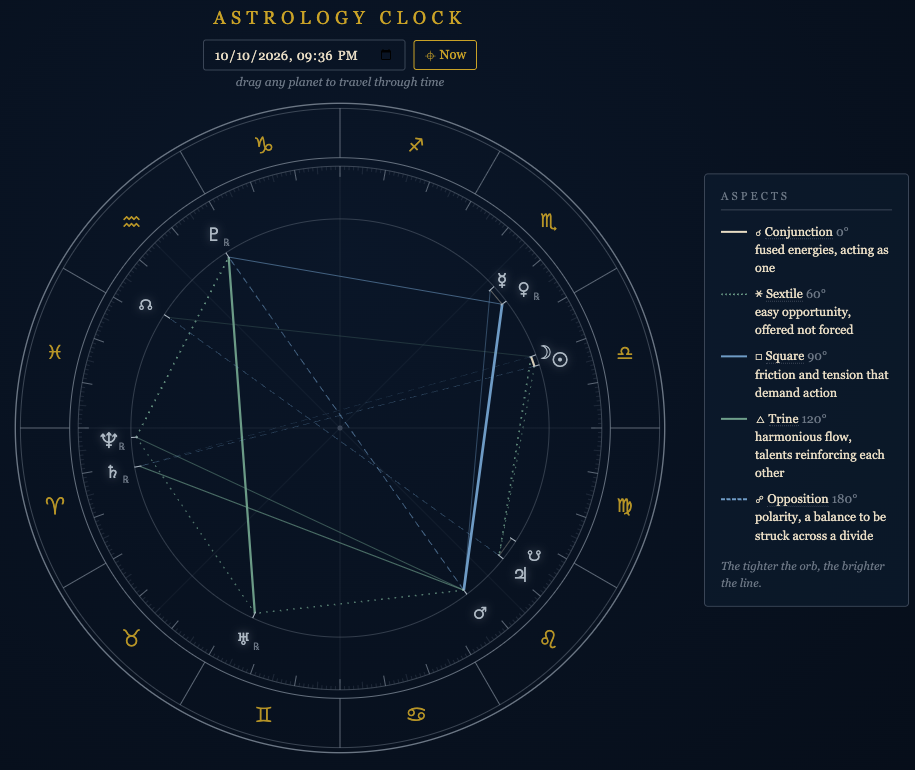

# Starcharts

**A live astrology clock: drag any planet to travel through time and watch the aspects change. Astrology is the subject; the engineering is in the astronomy.**

The wheel at [starcharts.me](https://starcharts.me) shows where the Sun, Moon, planets and lunar nodes sit right now. Grab a planet and drag it around the zodiac, and the clock solves for the moment that planet actually reaches that longitude, then redraws every other body and every aspect for that instant. Under the hood that means a real ephemeris, an inverse solver that copes with retrograde loops, and an accuracy audit against NASA JPL's Horizons system.

> Live: [starcharts.me](https://starcharts.me)



---

## Contents

- [Architecture](#architecture)
- [How positions are computed](#how-positions-are-computed)
- [The drag solver: `dateForLongitude`](#the-drag-solver-dateforlongitude)
- [Accuracy audit against JPL Horizons](#accuracy-audit-against-jpl-horizons)
- [Invariant tests](#invariant-tests)
- [Interpretation text](#interpretation-text)
- [Running it](#running-it)

---

## Architecture



- **`packages/astro-core`** holds all the math and all the words. It has no framework or DOM dependency. Every call into `astronomy-engine` goes through `ephemeris.ts`, which is the only file in the repo that imports the library. That isolation exists for a practical reason: the library ships as CommonJS, and vitest, plain Node/tsx and webpack disagree about its module shape, so `ephemeris.ts` resolves it once (`default ?? namespace`) and re-exports the symbols everything else uses.
- **`apps/web`** is the site. It consumes astro-core as source (`transpilePackages` in `next.config.mjs`). The wheel calls `dateForLongitude` on every drag frame.
- **`apps/mcp`** is a stateless Streamable HTTP MCP server (a fresh server and transport per request) with three read-only tools, a plain REST twin at `GET /api/chart`, a 32 KB body cap and a per-IP fixed-window rate limiter. It runs locally; it is not part of the App Hosting deploy.
- **Deploy.** Firebase App Hosting builds `apps/web` and serves it on managed Cloud Run (`apps/web/apphosting.yaml`), rolling out automatically on push via its GitHub integration. Cloudflare sits in front and a Transform Rule injects a secret `x-origin-fence` header; `apps/web/middleware.ts` rejects requests to the origin that lack it (constant-time comparison, with an exemption for Google's documented health-check ranges), so the edge cannot be bypassed by hitting the raw backend URL. GitHub Actions CI runs only `npm run typecheck` and `npm test`; it does not deploy.

---

## How positions are computed

Positions are **geocentric** and **tropical**, measured on the **true ecliptic of date** (the frame Western astrology uses: the zodiac is tied to the moving equinox, not the stars).

For the Sun and planets, `longitudeAt()` in `positions.ts` asks `astronomy-engine` for the geocentric vector with aberration correction (`GeoVector(body, date, true)`), which comes back in the J2000 mean-equator frame (EQJ). It then passes that vector to `Ecliptic()`, which applies precession and nutation to reach the true equator of date and rotates by the true obliquity into the true ecliptic of date. That is the same EQJ → ECT transform `astronomy-engine` exposes as the rotation matrix `Rotation_EQJ_ECT` (re-exported from `ephemeris.ts`). The Moon uses `EclipticGeoMoon()`, which returns the same true-ecliptic-of-date frame directly.

The lunar nodes are the one non-ephemeris quantity: the **mean** node from Meeus' linear formula (regressing about 0.053° per day), with the South Node exactly opposite by construction. Daily motion and the retrograde flag come from central differences of longitude.

---

## The drag solver: `dateForLongitude`

Dragging a planet asks the inverse question: *when* is Mars at 112°? `dateForLongitude(planet, targetLon, near, preferDirection)` in `solver.ts` returns the instant nearest `near` at which the planet reaches the target longitude.

**Newton first.** Newton's method needs the planet's rate of motion, and there is no analytic derivative here, so the solver estimates it numerically by probing a short interval ahead. Steps are clamped to a maximum size derived from the planet's mean motion, so one bad rate estimate cannot throw the iteration years away. It runs up to 25 iterations and accepts a result within 1e-4°.

**Why Newton fails near stations.** Seen from Earth, every planet except the Sun and Moon periodically appears to stop and reverse (retrograde motion). At a station the rate goes to zero, so the Newton step `error / rate` blows up; just past it the rate changes sign and Newton heads the wrong way. Within a retrograde loop the planet also crosses the same longitude up to three times, so "a solution" is not unique. The solver floors the rate near zero to keep steps finite, and when Newton still does not converge it returns `null` rather than a wrong answer.

**Bisection as the fallback.** The fallback samples f(t) = wrapDiff(lon(t) − target) across a window around `near`, collects every sign-change bracket (ignoring the ±180° seam of the wrap), picks the one nearest in time, and bisects it. Bisection only needs a bracket, not a derivative, so stations cannot defeat it. The scan runs in two tiers: a local window of about one synodic cycle (capped at 500 days), and, only if that finds nothing, a wider window sized from the slow planet's drift rate (capped at a century), so a fast drag on Neptune or Pluto still finds a crossing years away. The comment in `solver.ts` records that the second tier was added after the fuzz test in `core.test.ts` found the failure.

**Direction hysteresis.** The wheel passes the direction time was moving on the previous drag frame. If Newton lands behind that direction while a valid crossing exists ahead, the solver prefers the forward one, which keeps the clock from flickering between past and future branches mid-drag.

---

## Accuracy audit against JPL Horizons

`packages/astro-core/test/accuracy-audit.test.ts` is the launch gate. It compares `longitudeAt()` against **JPL Horizons (DE441), geocentric apparent ecliptic longitude of date**, which is the same frame astro-core targets, for **12 dates spread across 1900–2100** and **every body** (Sun, Moon, Mercury through Pluto), with a tolerance of **0.1°** per point. A second test fails if the worst error across all 120 points exceeds 0.05°, to catch systematic drift long before it threatens the real tolerance.

The Horizons values were fetched once from the Horizons API and frozen into the test file, so the suite is offline and deterministic and never depends on a live API. The lunar nodes are excluded because Horizons has no node target body and the mean node is an analytic formula rather than an ephemeris fit; they are covered by invariant tests instead.

Measured error against the frozen Horizons values (computed by running `longitudeAt()` over the test's own data at 00:00 UTC on each date):

| Body | Dates | Max error | Date of max | Mean error |
|---|---:|---:|---|---:|
| Sun | 12 | 5.7″ (0.0016°) | 2100-04-04 | 1.2″ |
| Moon | 12 | 69.3″ (0.0193°) | 2100-04-04 | 13.5″ |
| Mercury | 12 | 6.3″ (0.0018°) | 2100-04-04 | 1.9″ |
| Venus | 12 | 2.8″ (0.0008°) | 2100-04-04 | 1.4″ |
| Mars | 12 | 4.4″ (0.0012°) | 2100-04-04 | 1.2″ |
| Jupiter | 12 | 7.9″ (0.0022°) | 2008-12-25 | 2.8″ |
| Saturn | 12 | 9.1″ (0.0025°) | 2026-07-13 | 3.6″ |
| Uranus | 12 | 5.9″ (0.0016°) | 1936-11-03 | 2.7″ |
| Neptune | 12 | 17.5″ (0.0049°) | 2008-12-25 | 8.5″ |
| Pluto | 12 | 8.1″ (0.0022°) | 2100-04-04 | 3.3″ |

The worst point is the Moon in 2100 at about 0.019°, roughly a fifth of the tolerance. Every other body stays under 0.005°.

---

## Invariant tests

Some quantities have no convenient external reference, so the tests check physical facts they must satisfy instead.

- **Ascendant and MC.** Rather than comparing against another astrology program, `b3.test.ts` takes the computed Ascendant and Midheaven longitudes, converts each from the ecliptic of date to the equator of date to the observer's local horizon (`Rotation_ECT_EQD`, `Rotation_EQD_HOR`, `HorizonFromVector`, geometric horizon with no refraction), and asserts that the Ascendant sits on the horizon (altitude within 1e-3°) in the eastern half of the sky, and that the MC lies on the local meridian (azimuth within 0.01° of due north or south). Cases cover the northern and southern hemispheres and both east and west longitudes. (The houses module is built and tested but not yet exported from astro-core; the live site currently ships date scrubbing only.)
- **Lunar nodes.** The South Node is exactly opposite the North Node, the node regresses at about 0.053°/day, and nodes are never flagged retrograde.
- **Daily motion.** The Moon moves faster than 14.5°/day near perigee and slower than 12.5°/day near apogee; the Sun moves faster near perihelion than aphelion.
- **Moon phase and void-of-course.** Illumination is near 0 at an exact new moon and near 1 at full; a void-of-course period ends exactly at a sign ingress, with no exact Moon aspect inside it.
- **Solver.** A fuzz test throws random planet × date × target-offset combinations at `dateForLongitude` and checks that it converges and returns the crossing nearest in time.

---

## Interpretation text

The aspect, sign, planet and planet-in-sign pages are generated, not hand-written, by `interpret.ts`, which composes prose from per-body "voices" and per-aspect qualities. Each paragraph is chosen from several phrasings with a seed derived from the page, so pages differ from their neighbours but every page renders byte-identically each time. It is pure (strings in, strings out) and lives in astro-core beside the numbers, so the words have a single source just as the positions do; `apps/web` re-exports it rather than keeping its own copy.

As the site's About page puts it, the interpretive text draws on traditional and modern astrology and is offered **as tradition and reflection, not as prediction or fact**, and it is not medical, financial, or legal advice.

---

## Running it

Requires Node 20+ (CI uses Node 22) and npm.

```bash
npm ci
npm run typecheck   # tsc --noEmit in astro-core, mcp and web
npm test            # vitest in every workspace
```

The suite currently runs **242 tests**: 220 in astro-core, 9 in apps/mcp and 13 in apps/web.

```bash
npm run dev -w @starcharts/web        # the site, at http://localhost:3000
PORT=8787 npm start -w @starcharts/mcp  # MCP server: POST /mcp, GET /api/chart, GET /healthz
```

Any Streamable HTTP MCP client can connect to `http://localhost:8787/mcp`. For a quick check without one: `curl localhost:8787/api/chart`.



---

Copyright (c) 2026 Sam Tindal. All rights reserved (see [LICENSE](LICENSE)).
